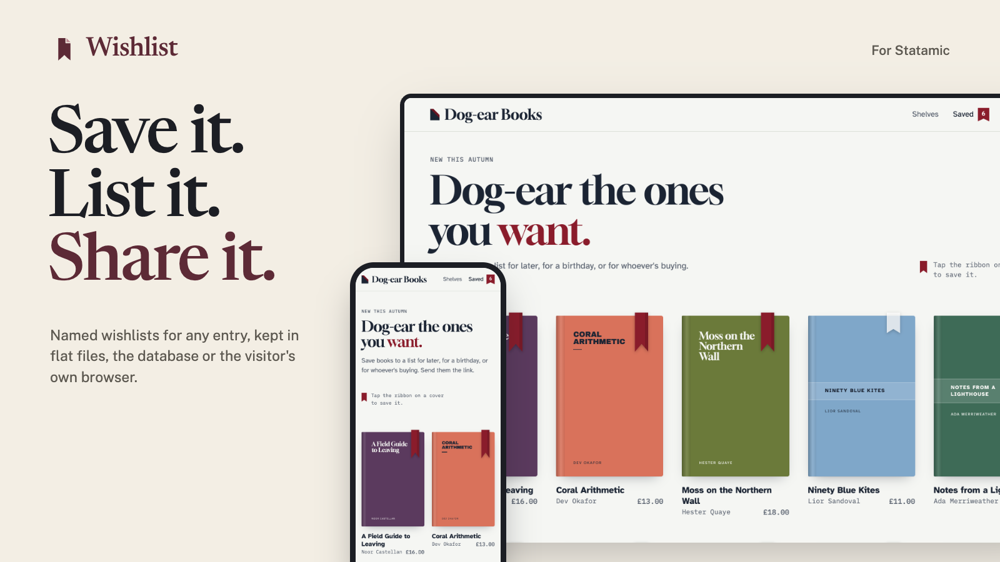

# Wishlist for Statamic

Let visitors save entries to wishlists, keep as many named lists as they like, and share any of them with a link.



Keep lists in **flat files**, in the **database**, or only in **the visitor's own browser**, so nothing about them is stored on your server. Your templates are the same whichever you choose.

## Features

- **Save anything.** Products, recipes, properties, events: any entry, in the collections you choose, and terms too if you like. Visitors can keep a note and a quantity with each item.
- **Several lists.** "Birthday", "Kitchen ideas", "For later". Make, rename, delete and pick between them, with a default for quick saves.
- **Share links.** Every list has a read-only page in your own layout, and a **Save these to my wishlist** button for whoever opens it. Links can be reset.
- **Three storage drivers.** Flat files indexed like entries, two database tables, or `localStorage` with the items carried in the share link. Move between files and the database with one command.
- **Guests welcome.** Visitors don't need an account. When they sign in, what they saved as a guest moves to their account.
- **Works without JavaScript.** Every button is a real form. With the script (no dependencies, no build step) the page updates in place, and it works on statically cached pages.
- **Your markup, in Antlers or Blade.** Tags and `data-` attributes, no imposed components or styles. Lists are drawn with your own partials. Every example in the docs has a Blade version.
- **Control Panel.** Content → Wishlists shows every list, what's on it, and the entries saved most, with permissions to view and delete.
- **For developers.** Events, a PHP API, a JSON API for headless front ends, and room for your own storage driver.

| Several lists, with notes | A list someone shared | The Control Panel |
| --- | --- | --- |
|  |  |  |

The screenshots are from Dog-ear Books, a made-up shop built only with the tags and attributes in [the docs](docs/README.md). **[Try the demo](https://github.com/1994limited/wishlist-statamic-demo)**: it runs locally in a few commands, with no licence needed. See [The demo shop](docs/demo.md).

## Requirements

- Statamic 6, PHP 8.3 or later.
- Statamic Pro for front-end user accounts and Control Panel permissions. Guests can keep lists without it.

## Installation

```bash
composer require 1994/wishlist-statamic
```

Add the script to your layout's `<head>`:

```antlers
{{ wishlist:scripts }}
```

<details>
<summary>Blade</summary>

```blade
<s:wishlist:scripts />
```

</details>

Add a save button wherever you show an entry:

```antlers
{{ wishlist:toggle id="{{ id }}" }}
    <button type="submit">
        <span data-wishlist-when="not-added">♡ Save</span>
        <span data-wishlist-when="added">♥ Saved</span>
    </button>
{{ /wishlist:toggle }}
```

<details>
<summary>Blade</summary>

```blade
<s:wishlist:toggle :id="$id">
    <button type="submit">
        <span data-wishlist-when="not-added">♡ Save</span>
        <span data-wishlist-when="added">♥ Saved</span>
    </button>
</s:wishlist:toggle>
```

</details>

And show the list on a page, with a partial of your own:

```antlers
{{ wishlist:render partial="wishlist" }}
    <p>Loading your wishlist…</p>
{{ /wishlist:render }}
```

<details>
<summary>Blade</summary>

```blade
<s:wishlist:render partial="wishlist">
    <p>Loading your wishlist…</p>
</s:wishlist:render>
```

</details>

Lists are kept in flat files by default. For the database, or the visitor's browser, set `WISHLIST_DRIVER` to `database` or `browser`.

## Documentation

Everything else is in [the documentation](docs/README.md):

- [Installation](docs/installation.md) and [storage drivers](docs/drivers.md)
- [Templates](docs/templates.md), [tags](docs/tags.md), [examples](docs/examples.md) and [the demo shop](docs/demo.md)
- [JavaScript](docs/javascript.md) and [share links](docs/sharing.md)
- [Guests and signing in](docs/guests.md) and [the Control Panel](docs/control-panel.md)
- [Configuration](docs/configuration.md), [HTTP API](docs/http-api.md), [PHP API](docs/php-api.md) and [troubleshooting](docs/troubleshooting.md)

## Licence

Wishlist is commercial software, sold through the [Statamic Marketplace](https://statamic.com/marketplace). Try it free on a local or development site. Each public site needs a licence. See [LICENSE.md](LICENSE.md).

## Support

Report bugs and ask questions through the addon's page on the Statamic Marketplace, or email [hello@1994.co.uk](mailto:hello@1994.co.uk).

## Development

```bash
composer install && npm install
vendor/bin/phpunit   # PHP: every driver, the actions, tags, shared pages, Control Panel
npm test             # the script: its share links match PHP's; the browser driver
npm run build        # the Control Panel pages
```
