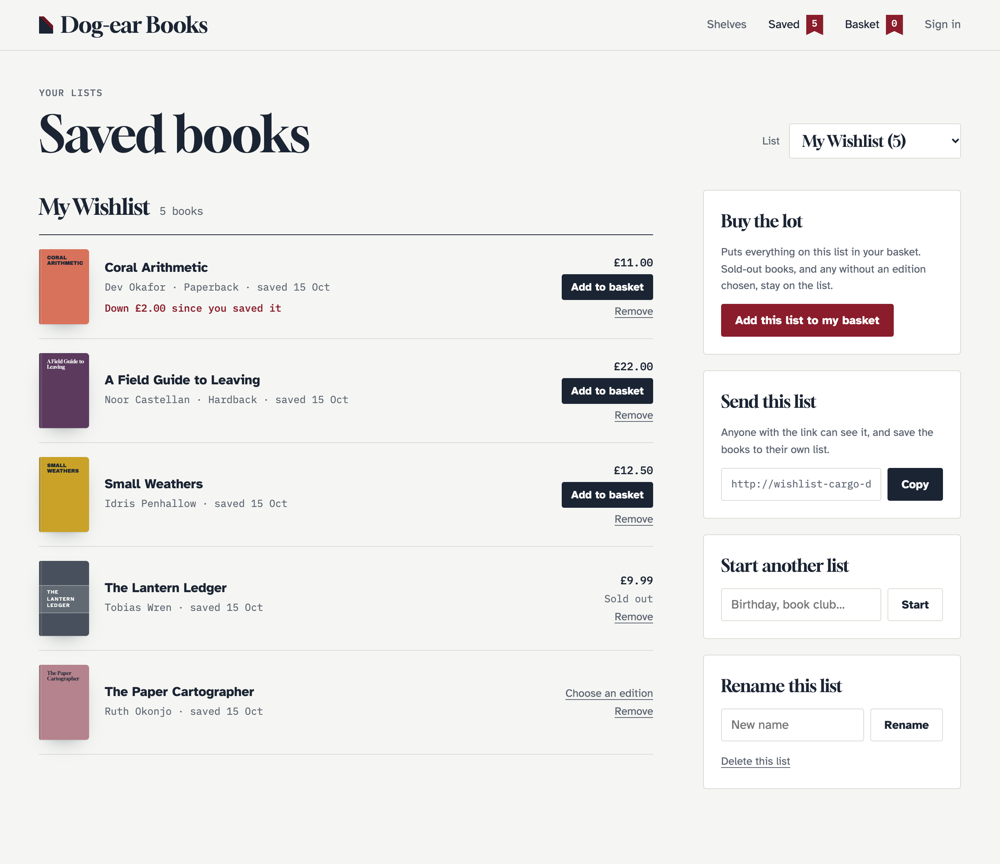

# Cargo

With [Cargo](https://builtwithcargo.dev) installed, Wishlist knows which entries are products. Lists then show each product's price and stock, keep the price it had when it was saved, save variants (sizes, editions, colours) as separate items, and can put a whole list in the basket.

There's nothing to turn on. Without Cargo, none of this appears and the `variant` parameters and `{{ wishlist:add_to_cart }}` do nothing.



**See it working:** [Dog-ear Books with Cargo](https://github.com/1994limited/wishlist-cargo-demo) is the demo shop with the books for sale, in hardback and paperback.

## Requirements

- Cargo 1.15 or later (`duncanmcclean/statamic-cargo`).
- Products are the entries in Cargo's product collections (`products.collections` in `config/statamic/cargo.php`). Those collections also need to be ones Wishlist allows (`collections` in `config/wishlist.php`, or `null` for any with a route).

## Saving products

A product saves like any other entry: the toggle, add and ribbon buttons in [Templates](templates.md) work unchanged.

### Variants

Each variant is its own item, so a shirt in M and the same shirt in L are two things on the list, each with its own price and stock. An item's ID is then the product's ID and the variant's key: `product-id#variant-key`.

Pass `variant` to the tags:

```antlers
{{ product_variants:options }}
    {{ wishlist:toggle :id="id" :variant="key" }}
        <button type="submit">
            <span data-wishlist-when="not-added">Save {{ variant }}</span>
            <span data-wishlist-when="added">{{ variant }} saved</span>
        </button>
    {{ /wishlist:toggle }}
{{ /product_variants:options }}
```

<details>
<summary>Blade</summary>

```blade
@foreach ($product_variants['options'] as $option)
    <s:wishlist:toggle :id="$id" :variant="$option['key']">
        <button type="submit">
            <span data-wishlist-when="not-added">Save {{ $option['variant'] }}</span>
            <span data-wishlist-when="added">{{ $option['variant'] }} saved</span>
        </button>
    </s:wishlist:toggle>
@endforeach
```

</details>

`variant` works on `wishlist:toggle`, `wishlist:add`, `wishlist:remove`, `wishlist:has` and `wishlist:toggle_attrs`. Inside an `{{ product_variants:options }}` loop, `id` is still the product's.

Or let the visitor choose, with a field named `variant` in a `{{ wishlist:add }}` form. The button's added/not-added state follows the choice:

```antlers
{{ wishlist:add :id="id" }}
    <select name="variant">
        {{ product_variants:options }}<option value="{{ key }}">{{ variant }}, {{ price }}</option>{{ /product_variants:options }}
    </select>
    <button type="submit">
        <span data-wishlist-when="not-added">Save to my list</span>
        <span data-wishlist-when="added">Saved</span>
    </button>
{{ /wishlist:add }}
```

<details>
<summary>Blade</summary>

```blade
<s:wishlist:add :id="$id">
    <select name="variant">
        @foreach ($product_variants['options'] as $option)
            <option value="{{ $option['key'] }}">{{ $option['variant'] }}, {{ $option['price'] }}</option>
        @endforeach
    </select>
    <button type="submit">
        <span data-wishlist-when="not-added">Save to my list</span>
        <span data-wishlist-when="added">Saved</span>
    </button>
</s:wishlist:add>
```

</details>

In JavaScript, use the joined ID: `Wishlist.add('product-id#M')`.

A key that isn't one of the product's variants is refused, as is a variant on anything that isn't a product.

A product with variants can also be saved without one, from a shelf or a card, say. It then shows on the list with `needs_choice`, and links back to its page to choose (see below). It's left out when the list goes in the basket.

## Showing products on a list

Each item on a list has the entry's own fields, `wishlist_item` (see [Tags](tags.md#item-variables)), and, for products, `cargo`:

| Variable | |
| --- | --- |
| `cargo:price_formatted` | The price now, in the site's currency: the variant's, or the product's. Empty when there's a choice still to make. |
| `cargo:price` | The same, in the smallest unit (pence, cents). |
| `cargo:variant` / `cargo:variant_name` | The saved variant's key and name. |
| `cargo:stock` | How many are left, when the product tracks stock. Empty when it doesn't. |
| `cargo:in_stock` | Whether it can go in the basket now. |
| `cargo:needs_choice` | A variant (or a [gift voucher's amount](#gift-vouchers)) still to choose on the product's page. `cargo:needs_variant` and `cargo:needs_amount` say which. |
| `cargo:saved_price_formatted` / `cargo:saved_price` | The price when it was saved. |
| `cargo:price_dropped` | Whether it's cheaper now than when it was saved. |
| `cargo:price_drop_formatted` / `cargo:price_drop` | By how much. |
| `cargo:product` | The product's ID, for Cargo's `{{ cart:add }}`. |

Use `{{ wishlist_item:id }}`, not `{{ id }}`, to remove an item: it includes the variant.

A list partial for `{{ wishlist:render }}`, with an "Add to basket" button on each product:

```antlers
{{ items }}
    <li>
        <a href="{{ url }}">{{ title }}</a>
        {{ if cargo:variant_name }}<span>{{ cargo:variant_name }}</span>{{ /if }}

        {{ if cargo:price_dropped }}
            <p>Down {{ cargo:price_drop_formatted }} since you saved it</p>
        {{ /if }}

        {{ if cargo:needs_choice }}
            <a href="{{ url }}">Choose a size</a>
        {{ else }}
            {{ cargo:price_formatted }}
            {{ if cargo:in_stock }}
                {{ cart:add }}
                    <input type="hidden" name="product" value="{{ cargo:product }}">
                    {{ if cargo:variant }}<input type="hidden" name="variant" value="{{ cargo:variant }}">{{ /if }}
                    <button type="submit">Add to basket</button>
                {{ /cart:add }}
            {{ else }}
                Sold out
            {{ /if }}
        {{ /if }}

        <button {{ wishlist:toggle_attrs :id="wishlist_item:id" }}>Remove</button>
    </li>
{{ /items }}
```

<details>
<summary>Blade</summary>

```blade
@foreach ($items as $item)
    @php($cargo = $item['cargo'] ?? [])
    <li>
        <a href="{{ $item['url'] }}">{{ $item['title'] }}</a>
        @if ($cargo['variant_name'] ?? null)<span>{{ $cargo['variant_name'] }}</span>@endif

        @if ($cargo['price_dropped'] ?? false)
            <p>Down {{ $cargo['price_drop_formatted'] }} since you saved it</p>
        @endif

        @if ($cargo['needs_choice'] ?? false)
            <a href="{{ $item['url'] }}">Choose a size</a>
        @elseif ($cargo)
            {{ $cargo['price_formatted'] }}
            @if ($cargo['in_stock'])
                <s:cart:add>
                    <input type="hidden" name="product" value="{{ $cargo['product'] }}">
                    @if ($cargo['variant'])<input type="hidden" name="variant" value="{{ $cargo['variant'] }}">@endif
                    <button type="submit">Add to basket</button>
                </s:cart:add>
            @else
                Sold out
            @endif
        @endif

        <button {!! Statamic::tag('wishlist:toggle_attrs')->param('id', $item['wishlist_item']['id'])->fetch() !!}>Remove</button>
    </li>
@endforeach
```

</details>

`{{ cart:add }}` is Cargo's own tag, so its stock checks and redirects apply. The same works on a [shared page](sharing.md#the-shared-page), so whoever opens a share link can buy from it, in the variant that was saved.

### Price drops

The price is kept when an item is saved, by the server, from the product itself: visitors can't set it. Items saved before Cargo was installed, and items saved without a variant, have no saved price, so `price_dropped` stays false for them. With the browser driver, a shared link carries only the items, not their saved prices.

## Adding a whole list to the basket

```antlers
{{ wishlist:add_to_cart }}
    <button type="submit">Add this list to my basket</button>
{{ /wishlist:add_to_cart }}
```

<details>
<summary>Blade</summary>

```blade
<s:wishlist:add_to_cart>
    <button type="submit">Add this list to my basket</button>
</s:wishlist:add_to_cart>
```

</details>

It puts every product on the list in the visitor's Cargo basket, with Cargo's own rules, one of each (or the item's `quantity`, if one was saved). Products that are sold out, or still need a variant or an amount chosen, stay on the list, and the message says how many couldn't be added. Nothing is taken off the list.

Without a `list` parameter, it acts on the list picked in a `data-wishlist-lists` picker, or the default list. Pass `list="{{ id }}"` inside `{{ wishlist:lists }}` for one per list. It works with every driver: with the browser driver, the script sends the list's items along with the form.

The form posts to `/!/wishlist/cart` and comes back to the page with a message ([`{{ wishlist:success }}`](templates.md#7-messages-and-errors)). Pass `redirect="/checkout"` to go straight to the basket instead. To change the wording, override `cart_all` and `cart_some` in the [messages file](configuration.md#translations).

## Gift vouchers

Gift Vouchers (`1994/gift-vouchers-statamic`) products save like any other. A voucher of any amount (`voucher_amount_type: open`) has no price until the buyer chooses one, so on a list it has `needs_choice` and `needs_amount`, and links back to its page. It's left out when the list goes in the basket. Fixed-amount vouchers show their price and go in the basket as usual.
