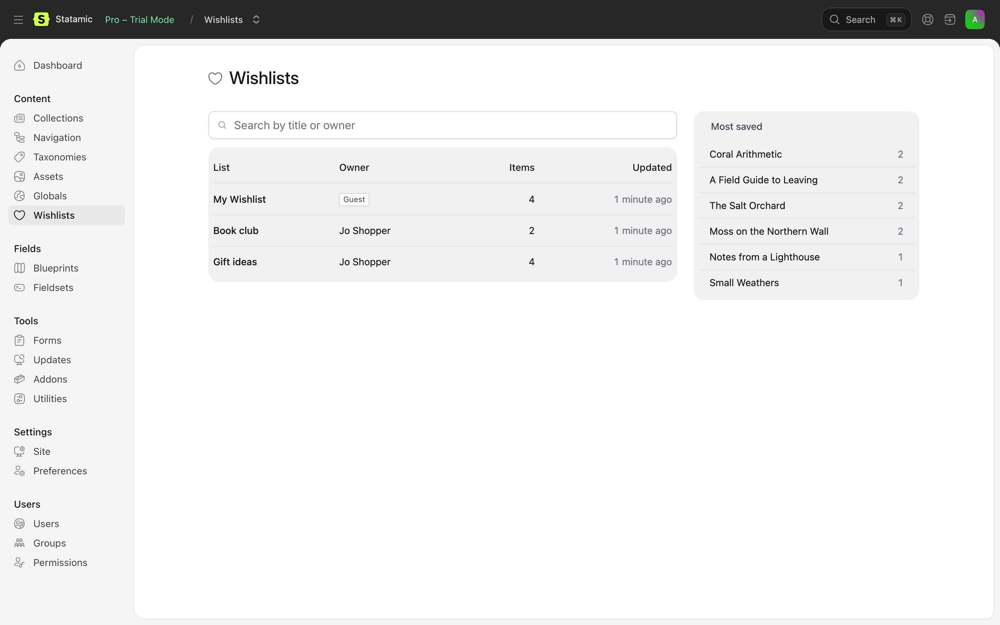
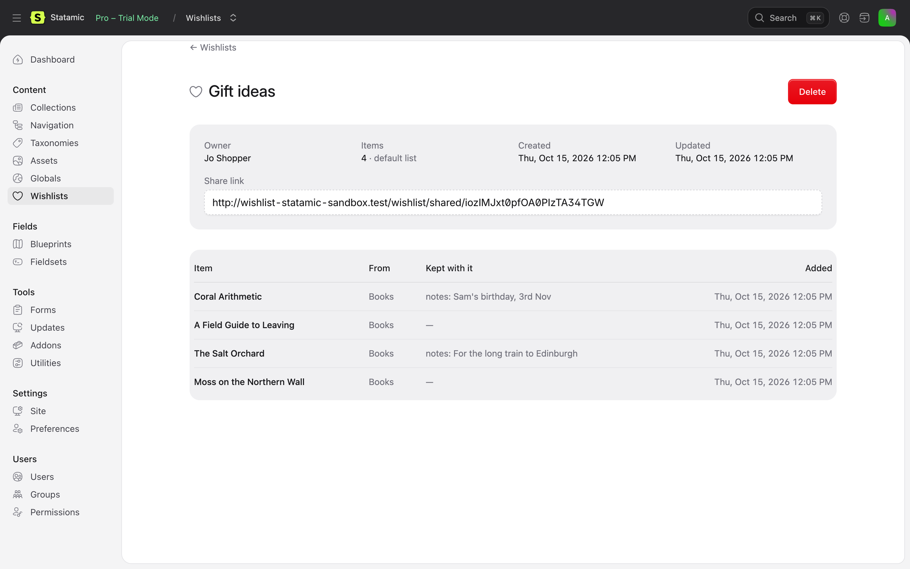

# The Control Panel

**Content → Wishlists** shows every visitor's lists, for the file and database drivers. With the browser driver, lists are only in visitors' browsers, so the page says so and shows nothing else.

## Wishlists

The list of lists, the most recently changed first, 25 to a page:

- **List:** its title. Click it to see what's on it.
- **Owner:** the user's name, linking to their account, or **Guest**.
- **Items** and **Updated**.

Search by a list's title or its owner's ID (`user:…`, `guest:…`).

Beside it, **Most saved** shows the ten entries on the most lists, linking to each entry. It's a quick read on what visitors want.

## A list

Opening a list shows its owner, how many items it has, whether it's their default, when it was made and last changed, and its share link, with a button to copy it.

Below that, each item: its title (linking to the entry), its collection, the values kept with it (notes, quantity) and when it was saved. Entries deleted since are shown as **Deleted**, with their ID.

**Delete** removes the list for good. Its share link stops working. The visitor isn't told: they'll find their list gone.

## Permissions

Under **Users → Roles**, in the **Wishlist** group:

| Permission | Lets someone |
| --- | --- |
| **View visitors' wishlists** | See Content → Wishlists and open lists. |
| **Delete wishlists** | Delete a list. Needs the one above. |

Super users have both. Roles and permissions need Statamic Pro.
