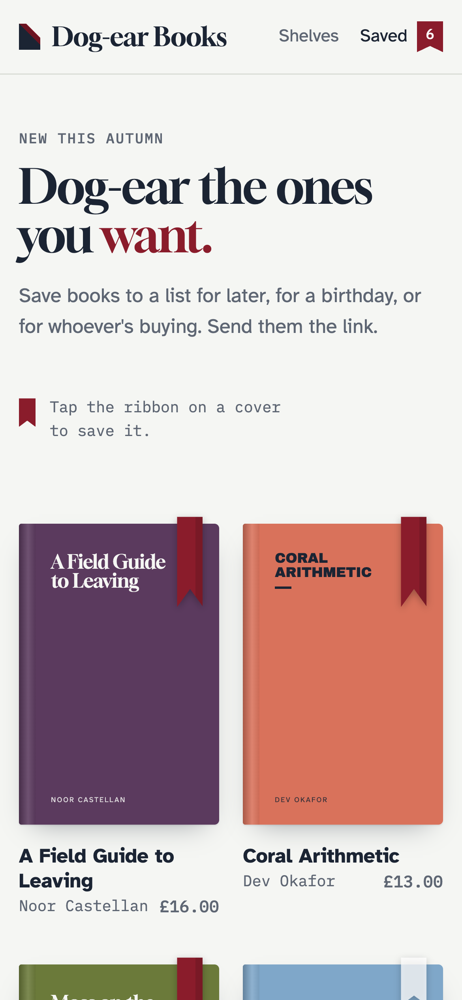

# Examples

Complete templates to copy. They work with all three drivers, with or without static caching. Class names are placeholders: use your own.

These are the templates behind the screenshots in these docs, simplified. The [demo shop](demo.md) has them in full, as a site you can run.



## Layout

The header count, messages for visitors without JavaScript, and the script:

```antlers
{{# resources/views/layout.antlers.html #}}
<head>
    …
    {{ wishlist:scripts }}
</head>
<body>
<header>
    <a href="/wishlist">
        Wishlist <span class="badge" data-wishlist-count>{{ wishlist:count }}</span>
    </a>
</header>

{{ if {wishlist:success} }}<p class="notice">{{ wishlist:success }}</p>{{ /if }}
{{ if {wishlist:error} }}<p class="notice notice--error">{{ wishlist:error }}</p>{{ /if }}

{{ template_content }}
</body>
```

## A product card

In a listing:

```antlers
{{ collection:products }}
    <article class="card">
        <a href="{{ url }}">{{ title }}</a>

        {{ wishlist:toggle id="{{ id }}" class="card__save" }}
            <button type="submit" aria-label="Save {{ title }}">
                <span data-wishlist-when="not-added">♡</span>
                <span data-wishlist-when="added">♥</span>
            </button>
        {{ /wishlist:toggle }}
    </article>
{{ /collection:products }}
```

## A product page

With a note and quantity kept with the item:

```antlers
<h1>{{ title }}</h1>

{{ wishlist:add id="{{ id }}" }}
    <label>Size or note <input name="notes"></label>
    <label>Quantity <input name="quantity" type="number" value="1" min="1"></label>
    <button type="submit">
        <span data-wishlist-when="not-added">Add to wishlist</span>
        <span data-wishlist-when="added">Update wishlist</span>
    </button>
{{ /wishlist:add }}
```

Adding an entry that's already saved updates its note and quantity.

## The wishlist page

The page's template:

```antlers
{{# resources/views/wishlist.antlers.html #}}
<h1>Your wishlists</h1>

<div class="toolbar">
    <label>List <select data-wishlist-lists></select></label>

    {{ wishlist:delete_list }}
        <button type="submit">Delete this list</button>
    {{ /wishlist:delete_list }}
</div>

{{ wishlist:render partial="wishlist" }}
    <p>Loading your wishlist…</p>
{{ /wishlist:render }}

<div class="share">
    <label>Share this list <input data-wishlist-share readonly value="{{ wishlist:share_url }}"></label>
    <button data-wishlist-copy-share>
        <span class="copy">Copy link</span><span class="copied">Copied</span>
    </button>
    <button class="share-only" data-wishlist-native-share data-wishlist-share-text="Books I'd love: :title">Share…</button>
</div>

{{ wishlist:rename_list }}
    <input name="title" placeholder="Rename this list" required>
    <button type="submit">Rename</button>
{{ /wishlist:rename_list }}

{{ wishlist:create_list }}
    <input name="title" placeholder="New list name" required>
    <button type="submit">Make a new list</button>
{{ /wishlist:create_list }}
```

The partial:

```antlers
{{# resources/views/partials/wishlist.antlers.html #}}
<h2>{{ title }} <small>({{ count }})</small></h2>

{{ if no_results }}
    <p>Nothing saved yet. <a href="/products">Have a look around.</a></p>
{{ else }}
    <ul class="grid">
        {{ items }}
            <li class="card">
                <a href="{{ url }}">{{ title }}</a>
                {{ if wishlist_item:quantity }}<span>× {{ wishlist_item:quantity }}</span>{{ /if }}
                {{ if wishlist_item:notes }}<p>{{ wishlist_item:notes }}</p>{{ /if }}
                <small>Saved {{ wishlist_item:added_at format="j M" }}</small>
                <button {{ wishlist:toggle_attrs id="{{ id }}" }}>Remove</button>
            </li>
        {{ /items }}
    </ul>
{{ /if }}
```

And the CSS for the bits the script switches:

```css
[data-wishlist-active="true"] button,
[aria-pressed="true"] { color: crimson; }

[data-wishlist-copy-share] .copied,
[data-wishlist-copy-share][data-wishlist-copied] .copy { display: none; }
[data-wishlist-copy-share][data-wishlist-copied] .copied { display: inline; }

[data-wishlist-can-share="false"] .share-only { display: none; }

form[aria-busy="true"] { opacity: .6; }
form[data-wishlist-error]::after { content: attr(data-wishlist-error); display: block; color: crimson; }
```

## The shared page

```antlers
{{# resources/views/wishlist/shared.antlers.html, with share.template set to "wishlist/shared" #}}
<p class="eyebrow">Shared wishlist</p>
<h1>{{ title }}</h1>

{{ if no_results }}
    <p>This wishlist is empty, or what was on it is no longer available.</p>
{{ else }}
    <ul class="grid">
        {{ items }}
            <li class="card">
                <a href="{{ url }}">{{ title }}</a>
                {{ if wishlist_item:notes }}<p>{{ wishlist_item:notes }}</p>{{ /if }}
                {{ wishlist:toggle id="{{ id }}" }}
                    <button type="submit">
                        <span data-wishlist-when="not-added">♡ Save</span>
                        <span data-wishlist-when="added">♥ Saved</span>
                    </button>
                {{ /wishlist:toggle }}
            </li>
        {{ /items }}
    </ul>

    {{ unless is_owner }}
        {{ wishlist:import }}
            <button type="submit">Save all of these to my wishlist</button>
        {{ /wishlist:import }}
    {{ /unless }}
{{ /if }}
```

## Signed-in only

To keep lists for signed-in users only, turn guests off in `config/wishlist.php`:

```php
'guests' => false,
```

and show the save button only to them:

```antlers
{{ if logged_in }}
    {{ wishlist:toggle id="{{ id }}" }}…{{ /wishlist:toggle }}
{{ else }}
    <a href="/login">Sign in to save</a>
{{ /if }}
```
