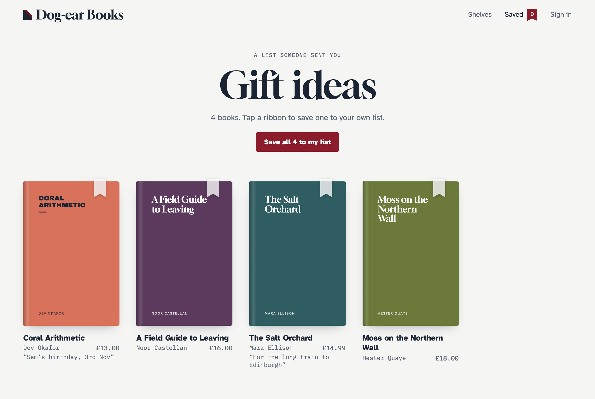

# Share links

Every list has a link that shows it, read-only, to anyone who has it. Whoever opens it can copy the items onto their own wishlist.

## How links work

### File and database drivers

```
https://example.com/wishlist/shared/zZsKAAT75wwQkoesaNFtKMls
```

The link holds a random 24-character key, not the list's ID, so nobody can find a list by guessing. It always shows the list as it is now, so changes after sharing appear.

To stop a link working, give the list a new one with `{{ wishlist:reset_share_link }}` or `Wishlist.resetShareLink()`. Every link sent before stops working.

### Browser driver

```
https://example.com/wishlist/shared?i=AAAAA6qqSqqKqgAAAAAAAw.AAAAAaqqSqqKqgAAAAAAAQ&t=Birthday
```

The server has no copy of the list, so the link carries the items themselves (`i`) and the title (`t`). Each entry's ID is packed into 22 characters, so a 50-item list makes a link of about 1,150 characters, which is fine for email, chat and QR codes. Links carry up to `share.max_items` items (200).

A browser driver link is a **snapshot**: changing the list afterwards doesn't change a link already sent. Copy the link again to share the latest.

## Getting the link

In templates:

```antlers
<input data-wishlist-share readonly value="{{ wishlist:share_url }}">
<button data-wishlist-copy-share>Copy link</button>
```

To open the phone's share sheet instead, use `data-wishlist-native-share` (see [JavaScript](javascript.md#attributes)).

`data-wishlist-share` fills in the picked list's link with every driver. `{{ wishlist:share_url }}` gives it on the server for the file and database drivers. In JavaScript: `Wishlist.shareUrl(listId)`.

To share by email or on WhatsApp:

```antlers
<a data-wishlist-share href="#">Open link</a>
<a href="mailto:?subject=My%20wishlist&body={{ wishlist:share_url | urlencode }}">Email it</a>
```

With the browser driver, build those links in JavaScript from `Wishlist.shareUrl()`, as the server doesn't know the list.

## The shared page




The link opens `wishlist/shared` (set by `share.route`), rendered with the addon's template inside your site's `layout`. The page sends `X-Robots-Tag: noindex`, so shared lists stay out of search results.

To make it your own, publish the template:

```bash
php please vendor:publish --tag=wishlist-views
```

That writes `resources/views/wishlist/shared.antlers.html`. Then point the config at it:

```php
'share' => [
    'template' => 'wishlist/shared',
    'layout' => 'layout',
    // …
],
```

The template gets:

| Variable | |
| --- | --- |
| `title` | The list's title. Also used by most layouts for `<title>`. |
| `items` | The items, with each entry's fields and `wishlist_item` (see [Tags](tags.md#item-variables)). Unpublished, scheduled, expired and deleted entries are left out. |
| `count`, `no_results` | How many, and whether there are none. |
| `is_owner` | True when the visitor is looking at their own list (server drivers). Hide the "save these" button then. |
| `share_key`, `encoded`, `references` | What `{{ wishlist:import }}` needs. You won't usually use them directly. |

The same values are also under `shared_wishlist`, for when a layout already uses `title` or `items` for something else: `{{ shared_wishlist:items }}…{{ /shared_wishlist:items }}`.

A starting point:

```antlers
<h1>{{ title }}</h1>
<p>{{ count }} {{ count == 1 ? 'item' : 'items' }}</p>

{{ items }}
    <a href="{{ url }}">{{ title }}</a>
    {{ if wishlist_item:notes }}<p>{{ wishlist_item:notes }}</p>{{ /if }}
{{ /items }}

{{ unless is_owner }}
    {{ wishlist:import }}<button type="submit">Save these to my wishlist</button>{{ /wishlist:import }}
{{ /unless }}
```

`{{ wishlist:import }}` copies the items onto the visitor's default list. With the browser driver the script does it in their browser. Items they already have, and anything over the list's limit, are skipped.

## Turning sharing off

Set `share.enabled` to `false` in `config/wishlist.php`. Share links aren't offered (`share_url` is empty) and the shared page returns 404.
