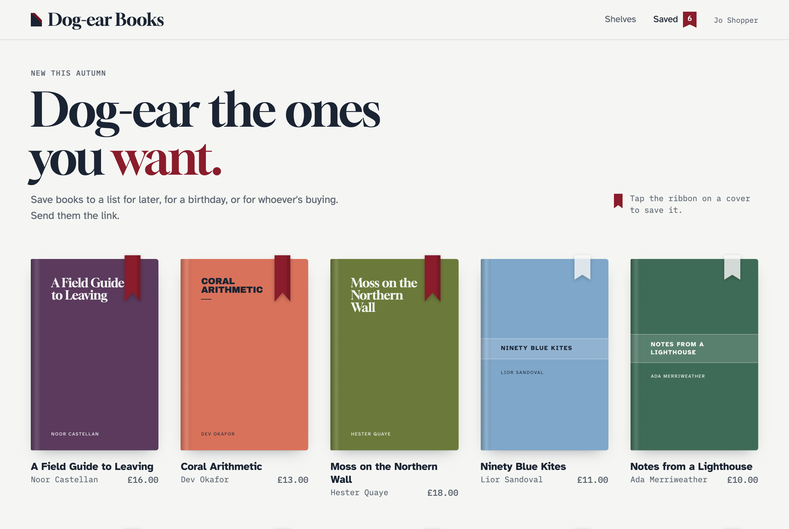
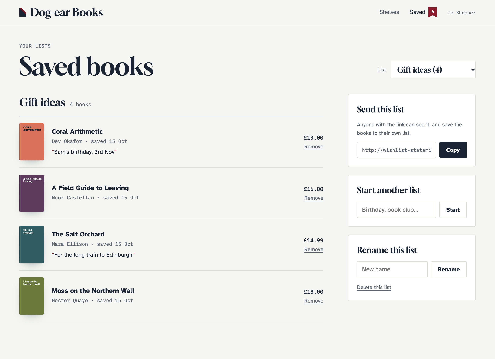

# Templates

This page builds a wishlist into a site step by step: the script, a save button, a count, a wishlist page, several lists and a shared page. Every step works with all three [drivers](drivers.md). For every tag and parameter, see [Tags](tags.md). For complete templates to copy, see [Examples](examples.md).



### Antlers or Blade

Every example is in Antlers, with the Blade version under **Blade**. In Blade:

- **Tags** are written `<s:wishlist:toggle :id="$id">…</s:wishlist:toggle>`, and single ones `<s:wishlist:count />`.
- **Values you test or loop over yourself** come from `Statamic::tag()`, for example `@if (Statamic::tag('wishlist:has')->param('id', $id)->fetch())`.
- **Partials** for `wishlist:render` can be `.blade.php` files. They get `$title`, `$count`, `$no_results` and `$items`, each item an array with `title`, `url`, `id` and `wishlist_item` (its notes, quantity and when it was added).
- **Visitors' text arrives already escaped**, as it does in Antlers: list titles, notes and other `wishlist_item` fields, and the success and error messages. Print those with `{!! !!}`, or `{{ }}` would escape them twice (`Books &amp;amp; Gifts`). The entry's own fields, like each item's `title` and `url`, aren't escaped by Wishlist, so print them with `{{ }}` as usual. Use `{!! !!}` only for these values, `toggle_attrs`, and `$template_content`.
- **The shared page** is an Antlers template placed in your layout as `$template_content`. If your layout is Blade and uses `@yield('content')`, either add `{!! $template_content ?? '' !!}` next to it, or point `share.template` at a Blade view of your own (see [The shared page](sharing.md#the-shared-page)).

## 1. Add the script

In your layout's `<head>`:

```antlers
{{ wishlist:scripts }}
```

<details>
<summary>Blade</summary>

```blade
<s:wishlist:scripts />
```

</details>

The script sends the forms below with `fetch()` so the page doesn't reload, and keeps buttons, counts and lists up to date. It's deferred, so it doesn't hold up the page. The tag also adds a few lines of CSS that show the right label on save buttons from the first paint. Everything except the browser driver also works without the script, as ordinary form posts.

## 2. A save button

Wherever you show an entry, in a listing or on its own page:

```antlers
{{ wishlist:toggle id="{{ id }}" }}
    <button type="submit">
        <span data-wishlist-when="not-added">♡ Save</span>
        <span data-wishlist-when="added">♥ Saved</span>
    </button>
{{ /wishlist:toggle }}
```

<details>
<summary>Blade</summary>

```blade
<s:wishlist:toggle :id="$id">
    <button type="submit">
        <span data-wishlist-when="not-added">♡ Save</span>
        <span data-wishlist-when="added">♥ Saved</span>
    </button>
</s:wishlist:toggle>
```

</details>

- `data-wishlist-when` marks the label for each state. The right one shows from the first paint, because the form says whether the entry is saved (`data-wishlist-active`), and stays right after each click.
- With the browser driver the server can't know, so both labels stay hidden (keeping their space) until the script has the list.
- `{{ added }}` is also available inside the tag, if you'd rather write the label with `{{ if added }}`.
- The form gets `data-wishlist-active="true"` and its button `aria-pressed="true"` while the entry is saved, for styling:

```css
[data-wishlist-active="true"] button { background: crimson; color: white; }
```

Prefer a plain button of your own? The script handles it:

```antlers
<button {{ wishlist:toggle_attrs id="{{ id }}" }}>
    <span data-wishlist-when="not-added">♡</span>
    <span data-wishlist-when="added">♥</span>
</button>
```

<details>
<summary>Blade</summary>

```blade
<button {!! Statamic::tag('wishlist:toggle_attrs')->param('id', $id)->fetch() !!}>
    <span data-wishlist-when="not-added">♡</span>
    <span data-wishlist-when="added">♥</span>
</button>
```

</details>

That one needs the script, since it isn't a form.

## 3. A count in the header

```antlers
<a href="/wishlist">Wishlist <span data-wishlist-count>{{ wishlist:count }}</span></a>
```

<details>
<summary>Blade</summary>

```blade
<a href="/wishlist">Wishlist <span data-wishlist-count><s:wishlist:count /></span></a>
```

</details>

The tag gives the count when the page is rendered. The attribute keeps it current as the visitor saves things, and fills it in with the browser driver.

## 4. The wishlist page

Make a page (say `/wishlist`) and a partial to draw the list, `resources/views/partials/wishlist.antlers.html`:

```antlers
<h2>{{ title }} ({{ count }})</h2>

{{ if no_results }}
    <p>Nothing saved yet.</p>
{{ else }}
    <ul>
        {{ items }}
            <li>
                <a href="{{ url }}">{{ title }}</a>
                {{ if wishlist_item:notes }}<small>{{ wishlist_item:notes }}</small>{{ /if }}
                <button {{ wishlist:toggle_attrs id="{{ id }}" }}>Remove</button>
            </li>
        {{ /items }}
    </ul>
{{ /if }}
```

<details>
<summary>Blade</summary>

```blade
{{-- resources/views/partials/wishlist.blade.php --}}
<h2>{!! $title !!} ({{ $count }})</h2>

@if ($no_results)
    <p>Nothing saved yet.</p>
@else
    <ul>
        @foreach ($items as $item)
            <li>
                <a href="{{ $item['url'] }}">{{ $item['title'] }}</a>
                @if ($item['wishlist_item']['notes'] ?? null)<small>{!! $item['wishlist_item']['notes'] !!}</small>@endif
                <button {!! Statamic::tag('wishlist:toggle_attrs')->param('id', $item['id'])->fetch() !!}>Remove</button>
            </li>
        @endforeach
    </ul>
@endif
```

</details>

Each item has all of its entry's fields (`title`, `url`, your own fields), plus `wishlist_item` with `added_at`, `notes`, `quantity` and any other [item fields](configuration.md#what-can-be-saved).

Then in the page's template:

```antlers
{{ wishlist:render partial="wishlist" }}
    <p>Loading your wishlist…</p>
{{ /wishlist:render }}
```

<details>
<summary>Blade</summary>

```blade
<s:wishlist:render partial="wishlist">
    <p>Loading your wishlist…</p>
</s:wishlist:render>
```

</details>

With the file and database drivers the partial is rendered straight away. With the browser driver, "Loading…" shows until the script has the list rendered. Either way it's drawn again whenever the list changes, so **Remove** takes the item away in place.

With a server driver you can also loop over the list directly, without a partial:

```antlers
{{ wishlist }}
    <h2>{{ title }}</h2>
    {{ items }}<a href="{{ url }}">{{ title }}</a>{{ /items }}
{{ /wishlist }}
```

<details>
<summary>Blade</summary>

```blade
<s:wishlist>
    <h2>{!! $title !!}</h2>
    @foreach ($items as $item)<a href="{{ $item['url'] }}">{{ $item['title'] }}</a>@endforeach
</s:wishlist>
```

</details>

That won't redraw itself or work with the browser driver, though. `{{ wishlist:render }}` does both.



## 5. Several lists

Visitors can keep more than one list: "Birthday", "Kitchen ideas". Add a picker, and forms to make, rename and delete lists:

```antlers
<label>List <select data-wishlist-lists></select></label>

{{ wishlist:render partial="wishlist" }}{{ /wishlist:render }}

{{ wishlist:rename_list }}
    <input name="title" placeholder="New name"> <button type="submit">Rename</button>
{{ /wishlist:rename_list }}

{{ wishlist:delete_list }}
    <button type="submit">Delete this list</button>
{{ /wishlist:delete_list }}

{{ wishlist:create_list }}
    <input name="title" placeholder="New list name" required> <button type="submit">Make a new list</button>
{{ /wishlist:create_list }}
```

<details>
<summary>Blade</summary>

```blade
<label>List <select data-wishlist-lists></select></label>

<s:wishlist:render partial="wishlist"></s:wishlist:render>

<s:wishlist:rename_list>
    <input name="title" placeholder="New name"> <button type="submit">Rename</button>
</s:wishlist:rename_list>

<s:wishlist:delete_list>
    <button type="submit">Delete this list</button>
</s:wishlist:delete_list>

<s:wishlist:create_list>
    <input name="title" placeholder="New list name" required> <button type="submit">Make a new list</button>
</s:wishlist:create_list>
```

</details>

The script fills the picker with the visitor's lists. The drawn list, the share link and the rename and delete forms all follow whichever list is picked, and a new list is picked as it's made. The pick is remembered for the rest of the visit, in a `wishlist_picked` cookie, so it's still picked on the next page. With the file and database drivers, `{{ wishlist:render }}` and `{{ wishlist:share_url }}` use it too (unless given a `list`), so the page arrives showing the picked list. Saves and counts without a `list` stay on the default list.

Save buttons put things on the visitor's **default** list (their first, unless they make another the default). To save to a particular list, pass `list="…"`:

```antlers
{{ wishlist:lists }}
    {{ wishlist:add id="{{ page:id }}" list="{{ id }}" }}
        <button type="submit">Add to {{ title }}</button>
    {{ /wishlist:add }}
{{ /wishlist:lists }}
```

<details>
<summary>Blade</summary>

```blade
{{-- Inside the loop, $id is each list's: keep the entry's first --}}
@php($entryId = $id)
<s:wishlist:lists>
    <s:wishlist:add :id="$entryId" :list="$id">
        <button type="submit">Add to {!! $title !!}</button>
    </s:wishlist:add>
</s:wishlist:lists>
```

</details>

(`{{ wishlist:lists }}` reads lists on the server, so this needs the file or database driver.)

Or let the visitor choose, with a picker named `list` inside the form. It works with every driver, starts on the picked list, and the button's added state follows it:

```antlers
{{ wishlist:add id="{{ id }}" }}
    <label>Save to <select name="list" data-wishlist-lists></select></label>
    <button type="submit">
        <span data-wishlist-when="not-added">Save</span>
        <span data-wishlist-when="added">Saved to this list</span>
    </button>
{{ /wishlist:add }}
```

<details>
<summary>Blade</summary>

```blade
<s:wishlist:add :id="$id">
    <label>Save to <select name="list" data-wishlist-lists></select></label>
    <button type="submit">
        <span data-wishlist-when="not-added">Save</span>
        <span data-wishlist-when="added">Saved to this list</span>
    </button>
</s:wishlist:add>
```

</details>

Without JavaScript the picker is empty, and the form saves to the default list. To change which list one-tap buttons save to, give visitors `{{ wishlist:make_default }}` (see [Tags](tags.md)).

## 6. Share links

```antlers
<input data-wishlist-share readonly value="{{ wishlist:share_url }}">
<button data-wishlist-copy-share>Copy link</button>
```

<details>
<summary>Blade</summary>

```blade
<input data-wishlist-share readonly value="<s:wishlist:share_url />">
<button data-wishlist-copy-share>Copy link</button>
```

</details>

The input shows the picked list's share link, and the button copies it. The button gets `data-wishlist-copied` for two seconds afterwards, to show "Copied".

On phones, add a button that opens the share sheet, so visitors can send the list straight to Messages or WhatsApp:

```antlers
<button class="share-only" data-wishlist-native-share data-wishlist-share-text="Books I'd love: :title">Share…</button>
```

<details>
<summary>Blade</summary>

```blade
<button class="share-only" data-wishlist-native-share data-wishlist-share-text="Books I'd love: :title">Share…</button>
```

</details>

```css
[data-wishlist-can-share="false"] .share-only { display: none; }
```

Where there's no share sheet (most desktop browsers, and pages on http) the button copies the link instead, so you can also leave it showing everywhere.

The link opens a read-only page with your layout. To change how it looks, see [Share links](sharing.md#the-shared-page).

## 7. Messages and errors

With the script, a form that fails gets `data-wishlist-error="…"`, with the message, and `document` gets a `wishlist:error` event. You can show it with CSS:

```css
form[data-wishlist-error]::after { content: attr(data-wishlist-error); color: crimson; }
```

or listen for the event (see [JavaScript](javascript.md#events)).

Without the script, the page reloads after each form. Show the message in your layout:

```antlers
{{ if {wishlist:success} }}<p class="notice">{{ wishlist:success }}</p>{{ /if }}
{{ if {wishlist:error} }}<p class="error">{{ wishlist:error }}</p>{{ /if }}
```

<details>
<summary>Blade</summary>

```blade
@if ($message = Statamic::tag('wishlist:success')->fetch())
    <p class="notice">{!! $message !!}</p>
@endif
@if ($message = Statamic::tag('wishlist:error')->fetch())
    <p class="error">{!! $message !!}</p>
@endif
```

</details>

## Statically cached pages

The script gets the visitor's lists and a fresh CSRF token from the server when the page loads, so save buttons, counts and `{{ wishlist:render }}` all work on fully cached pages. What the tags print when the page is cached is whoever's lists were rendered first. Use the `data-wishlist-*` attributes for anything personal on cached pages, or wrap those tags in `{{ nocache }}`.
